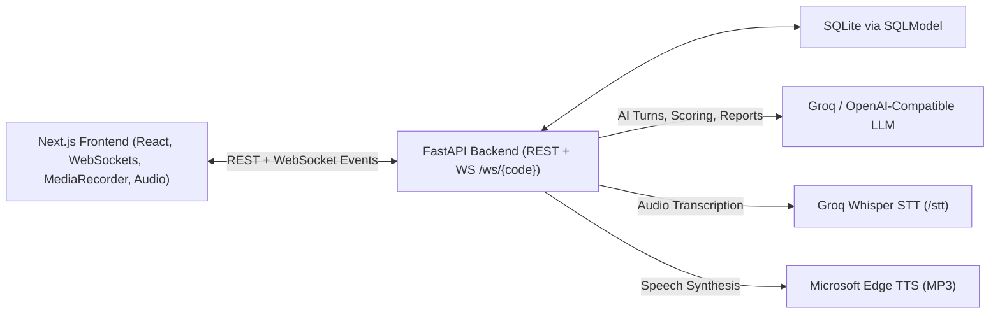

# GDArena

Real-time voice-first Group Discussion practice platform with AI participants, live scoring, and structured feedback reports.


---

## Overview

GDArena simulates a moderated, timed Group Discussion (GD) for candidates preparing for campus placements, technical and management interviews, and MBA admissions. Practising group discussions effectively usually requires coordinating several peers and a facilitator at the same time, which makes consistent practice difficult.

With GDArena, a single participant—or a small group alongside a moderator—can launch a discussion room in seconds. Open seats up to 10 total participants are filled automatically with distinct AI personas that raise their hands, respond to recent arguments in under 60 words, and speak aloud using server-generated neural voices.

The backend acts as the single source of truth for room state, countdown timers, raise-hand queue order, speech-to-text transcription, asynchronous turn scoring, and end-of-session evaluation reports.

## Table of Contents

- [Key Features](#key-features)
- [How It Works](#how-it-works)
- [Tech Stack](#tech-stack)
- [Screenshots](#screenshots)
- [Project Structure](#project-structure)
- [Getting Started](#getting-started)
- [Configuration](#configuration)
- [API Overview](#api-overview)
- [Running Tests](#running-tests)
- [Troubleshooting](#troubleshooting)
- [Roadmap](#roadmap)
- [Contributing](#contributing)
- [License](#license)
- [Author and Acknowledgements](#author-and-acknowledgements)

---

## Key Features

- **Voice-based participation**: Human participants record turns in the browser via `MediaRecorder` and submit audio to `POST /stt` (Groq Whisper), with a `"Use text instead"` fallback toggle for debugging.
- **AI participants with distinct personas and voices**: Fills empty seats up to `max_participants` (2 to 10) from 10 personas (including Aggressive Debater, Calm Analyst, Data-Driven Thinker, Empathetic Listener, and Devil's Advocate), each mapped to a dedicated `edge-tts` voice and speaking rate.
- **Low-latency turn transitions**: Background prefetching prepares the next AI participant's text and MP3 audio while the current AI speaker holds the floor, keeping inter-speaker pauses near `TURN_GAP_SECONDS` (`1.0s`).
- **Moderator and host controls**: Supports a dedicated `moderator` role (or promotes the first human player to host if no moderator joins) to start/end the discussion, grant or skip turns, and adjust participant scores (`-10` to `+10`).
- **Server-authoritative timers**: Broadcasts remaining session time and per-turn countdowns every second over WebSockets, automatically advancing when a speaker exceeds `turn_limit_seconds` (or `DEFAULT_TURN_LIMIT_SECONDS=60`).
- **Turn management with raise-hand queue**: Enforces one active speaker at a time from a live raise-hand queue with optional human queue priority (`HUMAN_QUEUE_PRIORITY=true`).
- **Asynchronous AI scoring**: Evaluates each completed turn in the background on `relevance`, `clarity`, `content`, and `teamwork` (0–10 each) plus a one-line comment, pushing updates to the live leaderboard.
- **End-of-session reports**: Generates per-participant totals, criterion averages, strengths, actionable improvements, and names the best performer.
- **Built-in topic bank**: Includes 37 topics in `backend/app/data/topics.json` across `current_affairs`, `business`, `social`, and `abstract`, or accepts a custom topic.

---

## How It Works

1. **Create a room**: On the setup screen, choose a custom topic or let the server pick randomly from the topic bank, set participant seats (2–10), session duration (default 10 minutes), and an optional per-turn limit.
2. **Join the lobby**: Enter the generated 6-character room code as a `player` or `moderator`. Clicking Join unlocks browser audio playback.
3. **Start the discussion**: The moderator (or host) starts the room (`lobby -> running`). Empty seats fill with AI personas, the server countdown starts, and the leaderboard populates with all participants.
4. **Take turns**: Participants raise their hand to enter the queue. Human participants record via microphone (`POST /stt` -> `submit_turn`) and AI participants generate concise points (`<= 60` words), synthesize MP3 audio (`GET /audio/{room_code}/{turn_id}.mp3`), and hold the floor until client `playback_ended` (or server duration fallback).
5. **Score and review**: Each turn is scored asynchronously in the background and reflected on the live leaderboard. When the timer expires or the moderator ends the session (`running -> finished`), the server cleans up temporary audio files and generates the final report.



---

## Tech Stack

| Layer | Technologies & Libraries |
|---|---|
| Frontend | Next.js (`^15.1.6`), React (`^19.0.0`), TypeScript (`^5.7.2`), Tailwind CSS (`^3.4.17`), `lucide-react` (`^0.468.0`), `@fontsource/inter` (`^5.1.1`) |
| Backend | Python `3.12+`, FastAPI (`>=0.115`), Uvicorn (`>=0.30`), Pydantic (`>=2.7`), `pydantic-settings` (`>=2.3`), `python-multipart` (`>=0.0.9`), `httpx` (`>=0.27`), `websockets` (`>=12.0`) |
| Database | SQLite via SQLModel (`>=0.0.22`) |
| AI / LLM | OpenAI Python SDK (`>=1.55`) targeting OpenAI-compatible APIs (default: Groq `openai/gpt-oss-120b`, fallback `qwen/qwen3.6-27b`) |
| Speech to Text | Groq Whisper (`whisper-large-v3-turbo`, fallback `whisper-large-v3`) via `openai` audio transcriptions API (`faster_whisper` stub available) |
| Text to Speech | `edge-tts` (`>=7.0.0`) with `mutagen` (`>=1.47.0`) for MP3 duration measurement |
| Testing | `pytest` (`>=8.0`) + end-to-end simulation script (`backend/scripts/run_fake_gd.py`) |

---

## Screenshots

Place captured screenshots under `docs/screenshots/` using the filenames below:

- Setup screen: 
- Live room screen: 
- Results and report screen: 

---

## Project Structure

```text
GDArena/
├── backend/
│   ├── app/
│   │   ├── api/
│   │   │   ├── rooms.py          # REST endpoints (/rooms, /stt, /audio, /tts/test, /health)
│   │   │   └── ws.py             # WebSocket handler (/ws/{code})
│   │   ├── core/
│   │   │   ├── errors.py         # Domain error definitions
│   │   │   ├── hub.py            # Non-blocking per-room WebSocket fan-out
│   │   │   ├── registry.py       # In-memory room registry and SQLite reload
│   │   │   └── runtime.py        # Room state machine, timers, turns, prefetch, report builder
│   │   ├── data/
│   │   │   └── topics.json       # 37 GD topics across 4 categories
│   │   ├── services/
│   │   │   ├── ai_agent.py       # AI prompt builder, speech cleanup, hand-raise probabilities
│   │   │   ├── llm.py            # OpenAI-compatible LLM wrapper, retries, JSON repair, /models check
│   │   │   ├── personas.py       # 10 distinct AI personas with Edge TTS voices and rates
│   │   │   ├── scoring.py        # Per-turn JSON scoring, leaderboard maths, final feedback
│   │   │   ├── stt.py            # Speech-to-text provider interface (Groq Whisper, stubs)
│   │   │   ├── topics.py         # Topic bank loader
│   │   │   └── tts.py            # Server-side Edge TTS, temp MP3 storage, voice check
│   │   ├── config.py             # Environment settings (pydantic-settings)
│   │   ├── db.py                 # SQLite engine and session helpers
│   │   ├── main.py               # FastAPI entry point and startup verification
│   │   ├── models.py             # SQLModel database tables
│   │   └── schemas.py            # REST request validation schemas
│   ├── scripts/
│   │   └── run_fake_gd.py        # End-to-end automated GD test script
│   ├── tests/
│   │   ├── test_full_gd.py       # Pytest wrapper for run_fake_gd.py
│   │   └── test_llm.py           # Unit tests for LLM, STT, TTS, prefetch, turn flow
│   ├── .env.example              # Backend environment template
│   ├── API_CONTRACT.md           # Full REST and WebSocket contract
│   ├── README.md                 # Backend-specific documentation
│   └── requirements.txt          # Python dependencies
├── frontend/
│   ├── src/
│   │   ├── app/
│   │   │   ├── join/page.tsx     # Join room screen
│   │   │   ├── room/[code]/page.tsx # Live lobby, discussion table, and results views
│   │   │   ├── layout.tsx        # Root Next.js layout
│   │   │   └── page.tsx          # Home / room setup screen
│   │   ├── components/           # UI panels (RoundTable, TurnControls, TranscriptPanel, etc.)
│   │   ├── hooks/
│   │   │   ├── useAiSpeech.ts    # Preloaded HTMLAudioElement queue, autoplay handling, test voice
│   │   │   └── useRoomSocket.ts  # Reconnecting WebSocket client hook
│   │   └── lib/                  # Typed API client, config, storage, speech unlock, types
│   ├── .env.example              # Frontend environment template
│   ├── README.md                 # Frontend-specific documentation
│   └── package.json              # Node dependencies and scripts
├── LICENSE                       # MIT License
└── README.md                     # Repository overview and setup guide
```

---

## Getting Started

### Prerequisites

- **Python**: 3.12 or higher
- **Node.js**: 20 or higher (with `npm`)
- **Groq API key**: required for live LLM turns, scoring, and Whisper transcription (or set `LLM_PROVIDER=mock` and `STT_PROVIDER=mock` for offline testing)
- **Browser**: modern desktop or mobile browser with microphone permission for voice input

### Backend Setup

```bash
cd backend
python3 -m venv .venv
source .venv/bin/activate
pip install -r requirements.txt
cp .env.example .env
```

Open `backend/.env` and set your `GROQ_API_KEY`. Then start the API server:

```bash
uvicorn app.main:app --reload --port 8000
```

On startup, the backend queries `GET /models` against `LLM_BASE_URL` and `edge_tts.list_voices()` to log whether your configured LLM, Whisper, and Edge TTS voices are available.

### Frontend Setup

In a second terminal:

```bash
cd frontend
npm install
cp .env.example .env.local
npm run dev
```

Open `http://localhost:3000` in your browser.

### Try It with a Single Browser Tab

1. On `http://localhost:3000`, enter a custom topic (or select **Let moderator choose**), pick `4` participants and `3` minutes, and click **Create Room**.
2. On the Join screen, enter your name, leave **Player** selected, and click **Join Room** (this user gesture unlocks browser audio playback). Because no separate moderator joins, you act as **Player (Host)** with both speaking controls and the Moderator Panel.
3. Click **Test voice** in the top header to verify server-side AI audio plays through your speakers.
4. Click **Start Discussion**. Empty seats fill with AI participants and the server timer starts.
5. Wait roughly 1–2 seconds for an AI participant to take the floor and speak aloud, or click **Raise Hand**. When your seat shows **Speaking**, click **Click to Speak (Microphone)**, grant browser microphone permission when prompted, speak your point, and click again to stop, transcribe, and submit.
6. Use the **Moderator Panel** to adjust points, inspect turn score comments, or click **End GD** to generate the final report.

---

## Configuration

### Backend (`backend/.env`)

| Variable | Description | Default | Required |
|---|---|---|---|
| `LLM_PROVIDER` | LLM backend (`groq`, `openai`, `openai_compatible`, `mock`) | `groq` | No |
| `GROQ_API_KEY` | Groq API key used when `LLM_API_KEY` is unset | `None` | Yes (for Groq) |
| `LLM_API_KEY` | Generic API key (takes precedence over `GROQ_API_KEY`) | `None` | No |
| `LLM_BASE_URL` | OpenAI-compatible base URL | `https://api.groq.com/openai/v1` | No |
| `LLM_MODEL` | Primary chat completion model | `openai/gpt-oss-120b` | No |
| `LLM_FALLBACK_MODEL` | Fallback model if `LLM_MODEL` is missing from `/models` | `qwen/qwen3.6-27b` | No |
| `LLM_REASONING_EFFORT` | Reasoning effort passed to compatible models (`low`, `medium`, `high`, or empty) | `low` | No |
| `LLM_TIMEOUT_SECONDS` | Per-request LLM HTTP timeout in seconds | `30.0` | No |
| `LLM_MAX_RETRIES` | Retries on `429` / `5xx` / transient errors | `1` | No |
| `LLM_BACKOFF_BASE_SECONDS` | Initial exponential backoff delay | `1.0` | No |
| `LLM_BACKOFF_MAX_SECONDS` | Maximum backoff delay | `30.0` | No |
| `LLM_MAX_CONCURRENCY` | Max concurrent LLM requests | `4` | No |
| `DATABASE_URL` | SQLAlchemy/SQLModel database URL | `sqlite:///.../backend/gd_arena.db` | No |
| `CORS_ORIGINS` | Comma-separated allowed CORS origins | `*` | No |
| `LOG_LEVEL` | Python logging level | `INFO` | No |
| `AI_SPEAKING_WPM` | Fallback AI floor-hold rate in words/minute when TTS audio duration is unavailable (`0` disables hold) | `150` | No |
| `AI_GENERATION_TIMEOUT_SECONDS` | Timeout for AI turn text generation | `45.0` | No |
| `AI_HAND_RAISE_MULTIPLIER` | Multiplier on per-second AI hand-raise probability | `1.0` | No |
| `AI_IDLE_NUDGE_SECONDS` | Idle delay before an AI opens when floor and queue are empty | `2.5` | No |
| `AI_MAX_QUEUED` | Max AI participants allowed in the queue simultaneously | `2` | No |
| `DEFAULT_TURN_LIMIT_SECONDS` | Default floor timeout when room `turn_limit_seconds` is `null` | `60` | No |
| `TURN_GAP_SECONDS` | Pause between consecutive AI speakers | `1.0` | No |
| `AUDIO_END_BUFFER_SECONDS` | Extra fallback margin added to MP3 duration | `0.2` | No |
| `HUMAN_QUEUE_PRIORITY` | Queue human participants ahead of waiting AIs | `true` | No |
| `MAX_HUMAN_TURN_CHARS` | Character cap on submitted human turns | `2000` | No |
| `STT_PROVIDER` | Speech-to-text provider (`whisper`, `faster_whisper`, `text`, `mock`) | `whisper` | No |
| `STT_MODEL` | Primary Whisper model name | `whisper-large-v3-turbo` | No |
| `STT_FALLBACK_MODEL` | Fallback Whisper model if primary is missing from `/models` | `whisper-large-v3` | No |
| `TTS_PROVIDER` | Text-to-speech provider (`edge`, `none`, `mock`) | `edge` | No |

### Frontend (`frontend/.env.local`)

| Variable | Description | Default | Required |
|---|---|---|---|
| `NEXT_PUBLIC_API_URL` | Backend REST base URL | `http://localhost:8000` | No |
| `NEXT_PUBLIC_WS_URL` | Backend WebSocket base URL (derived from `NEXT_PUBLIC_API_URL` if unset) | `ws://localhost:8000` | No |

---

## API Overview

Full request/response schemas and WebSocket payloads are documented in [`backend/API_CONTRACT.md`](backend/API_CONTRACT.md).

### REST Endpoints

| Method | Path | Purpose |
|---|---|---|
| `GET` | `/health` | Server health and active LLM, STT, and TTS providers |
| `GET` | `/topics` | List built-in GD topics (filterable by `category`) |
| `GET` | `/personas` | List available AI personas and voices |
| `POST` | `/rooms` | Create a room and receive a 6-character room code |
| `GET` | `/rooms/{code}` | Fetch full `RoomSnapshot` |
| `POST` | `/rooms/{code}/join` | Join as `player` or `moderator` and receive a WS token |
| `GET` | `/rooms/{code}/transcript` | Fetch completed turns |
| `GET` | `/rooms/{code}/leaderboard` | Fetch current or final leaderboard |
| `GET` | `/rooms/{code}/report` | Fetch final evaluation report (`202` while generating) |
| `POST` | `/stt` | Transcribe uploaded audio (`multipart/form-data`) via STT provider |
| `GET` | `/audio/{room_code}/{turn_id}.mp3` | Stream synthesized MP3 audio for an AI turn |
| `POST` | `/tts/test` | Generate a short sample MP3 to verify server-side TTS |

### WebSocket (`/ws/{code}?token=...`)

| Direction | Message Types |
|---|---|
| Client -> Server | `ping`, `get_state`, `start_gd`, `end_gd`, `raise_hand`, `lower_hand`, `submit_turn`, `yield_turn`, `grant_turn`, `skip_speaker`, `adjust_score`, `playback_ended` |
| Server -> Client | `welcome`, `state`, `pong`, `participants`, `gd_started`, `timer`, `queue`, `speaker_changed`, `transcript_entry`, `turn_skipped`, `turn_scored`, `score_adjusted`, `leaderboard`, `gd_ended`, `report_ready`, `report_failed`, `error` |

---

## Running Tests

### Backend Unit & Integration Suite

```bash
cd backend
source .venv/bin/activate
pytest -v
```

### Standalone End-to-End Fake GD Script

```bash
cd backend
source .venv/bin/activate

# Offline mock LLM and TTS (starts a temporary server automatically)
python scripts/run_fake_gd.py

# Use the real LLM configured in backend/.env
python scripts/run_fake_gd.py --real

# Run against an already running server
python scripts/run_fake_gd.py --base-url http://localhost:8000
```

### Frontend Typecheck, Lint, and Build

```bash
cd frontend
npm run typecheck
npm run lint
npm run build
```

---

## Troubleshooting

- **AI participants do not respond**
  - Check `LLM_MODEL` in `backend/.env` and watch the backend startup logs. Providers periodically decommission older models (for example, `llama-3.3-70b-versatile` was replaced by `openai/gpt-oss-120b` with fallback `qwen/qwen3.6-27b`). The startup `/models` check prints `OK`, `WARN`, or `FAIL` and logs any fallback applied. Always restart `uvicorn` after editing `.env`.
- **No AI voice or microphone not working**
  - Check that your browser has microphone permission granted for `http://localhost:3000` and system/tab volume is up.
  - Browsers block automatic audio playback before user interaction: clicking **Join Room**, **Start Discussion**, or **Raise Hand** unlocks playback. If the browser still blocks audio, click the **"Click here to enable AI voices"** banner at the top of the room, or click **Test voice** in the header to verify `POST /tts/test`.
- **Speech-to-text failing or rate limited**
  - Groq Whisper enforces free-tier rate and audio quotas (`429`). If you hit rate limits or want offline transcription, implement the `FasterWhisperSTT` stub in `backend/app/services/stt.py` and set `STT_PROVIDER=faster_whisper`, or use the `"Use text instead"` link below the microphone button for debugging.

---

## Roadmap

- Multi-human real-time voice rooms over WebRTC using LiveKit
- Local `faster-whisper` implementation for completely offline STT
- User accounts, authentication, and persistent session history
- UI editor for managing custom topic banks and persona presets
- Production deployment guide (Docker Compose, reverse proxy, TLS for WebSockets and microphone access)

---

## Contributing

1. Fork the repository.
2. Create a feature branch (`git checkout -b feat/your-feature`).
3. Use conventional commit messages (e.g., `feat: add local faster-whisper stt`, `fix: handle empty audio upload`).
4. Run `pytest -v` in `backend/` and `npm run typecheck && npm run lint && npm run build` in `frontend/`.
5. Open a pull request describing your changes.

---

## License

This project is licensed under the MIT License. See [`LICENSE`](LICENSE) for details.

---

## Author and Acknowledgements

Built by **[Your Name]** — [GitHub](https://github.com/your-username) | [LinkedIn](https://www.linkedin.com/in/your-profile)

Acknowledgements:
- [FastAPI](https://fastapi.tiangolo.com/) and [SQLModel](https://sqlmodel.tiangolo.com/)
- [Next.js](https://nextjs.org/) and [Tailwind CSS](https://tailwindcss.com/)
- [OpenAI Whisper](https://github.com/openai/whisper) and [Groq](https://groq.com/)
- [edge-tts](https://github.com/rany2/edge-tts)

