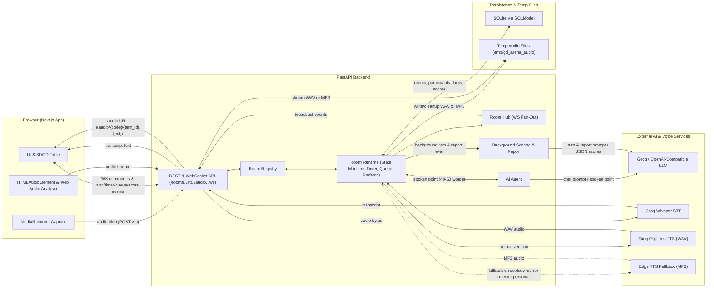
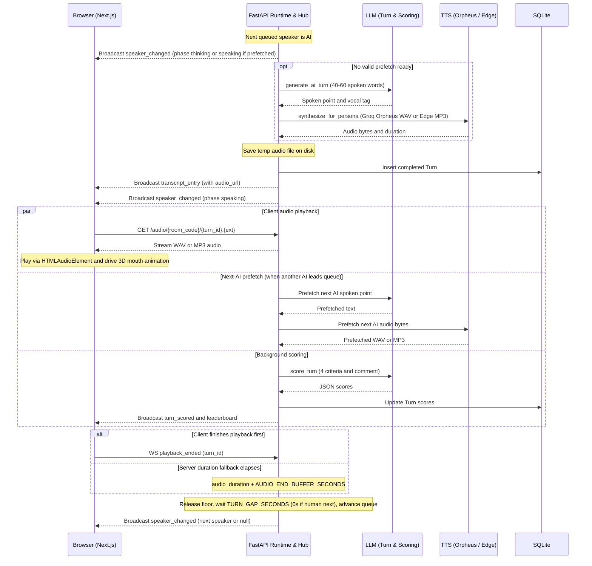
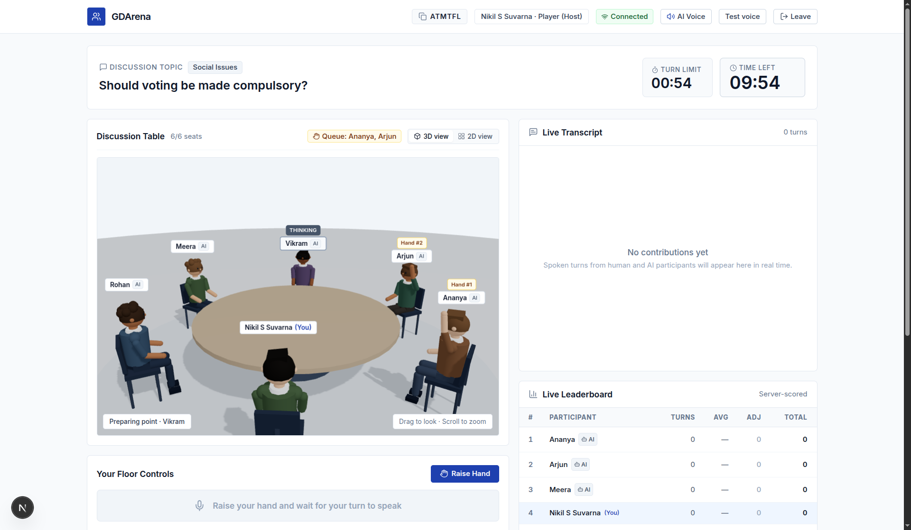
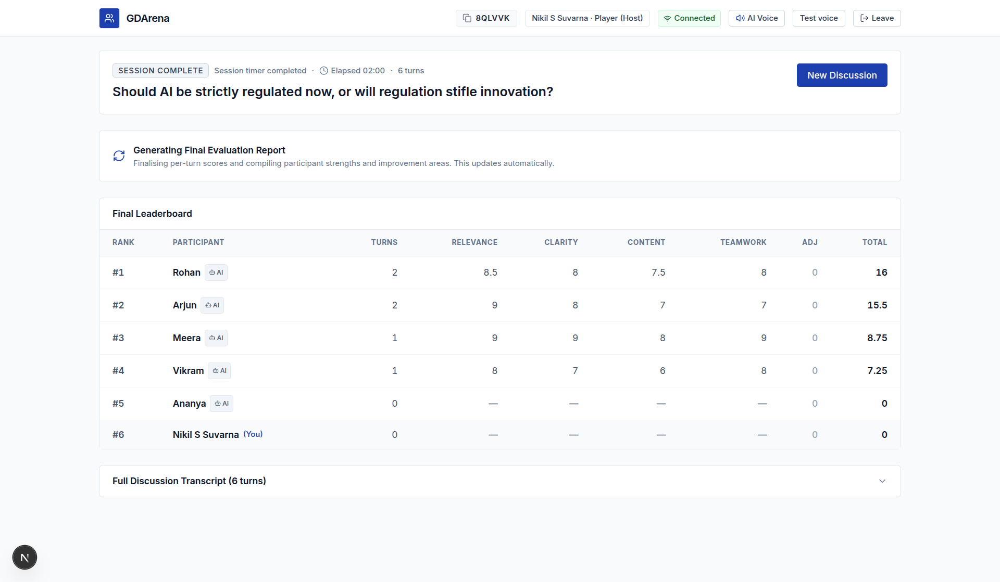
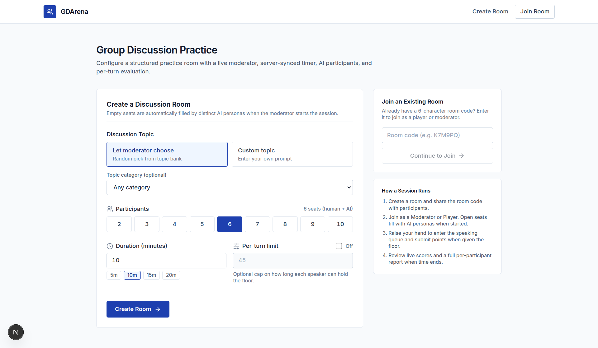
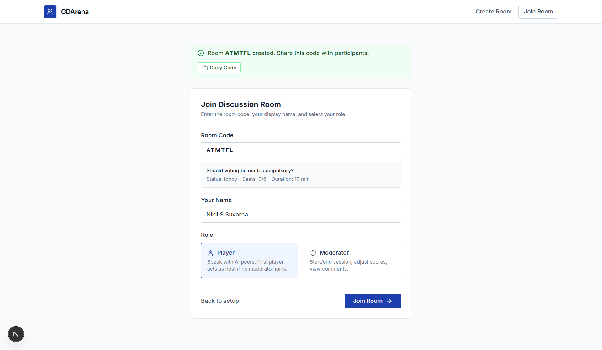
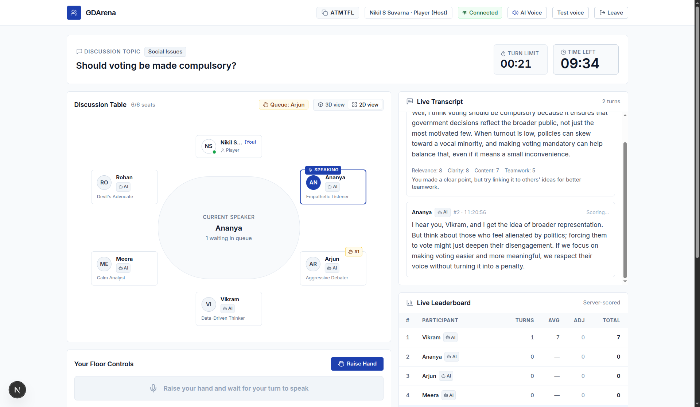
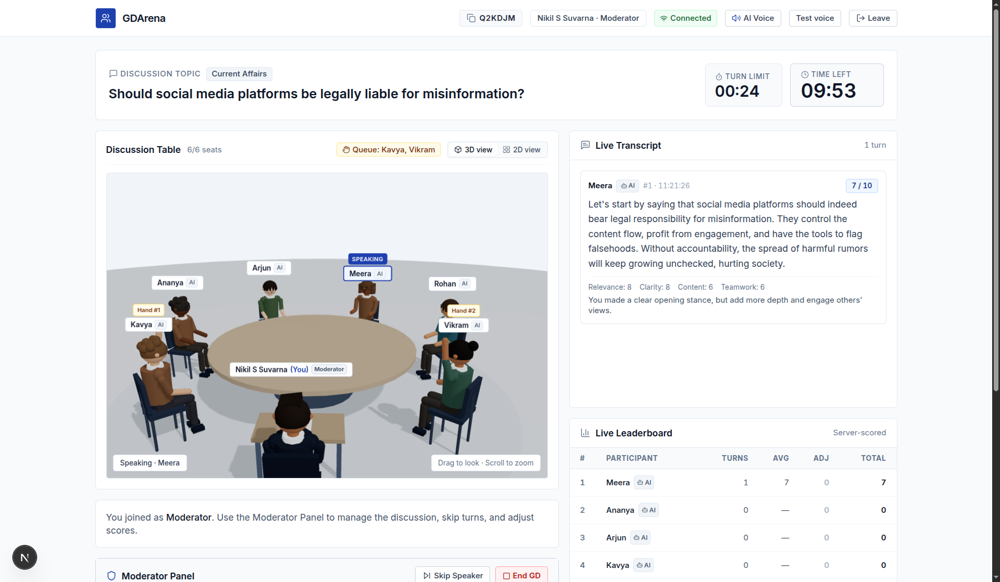

# GDArena

Real-time voice-first Group Discussion practice platform with a 3D conference room table, AI participants, live scoring, and structured feedback reports.


---

## Overview

GDArena simulates a moderated, timed Group Discussion (GD) for candidates preparing for campus placements, technical and management interviews, and MBA admissions. Practising group discussions effectively usually requires coordinating several peers and a facilitator at the same time, which makes consistent practice difficult.

With GDArena, a single participant—or a small group alongside a moderator—can launch a discussion room in seconds. Open seats up to 10 total participants are filled automatically with distinct AI personas seated around an interactive 3D conference table (with a 2D view toggle). AI participants raise their hands, respond to recent arguments in 40 to 60 spoken words, and speak aloud using server-generated neural voices.

The FastAPI backend acts as the single source of truth for room state, countdown timers, raise-hand queue order, speech-to-text transcription, asynchronous turn scoring, and end-of-session evaluation reports.

## Table of Contents

- [Key Features](#key-features)
- [Architecture](#architecture)
- [How It Works](#how-it-works)
- [Screenshots](#screenshots)
- [Tech Stack](#tech-stack)
- [Project Structure](#project-structure)
- [Getting Started](#getting-started)
- [Configuration](#configuration)
- [Cold Starts on Render's Free Tier](#cold-starts-on-renders-free-tier)
- [Usage-Limit Alerts (Groq LLM & Whisper)](#usage-limit-alerts-groq-llm--whisper)
- [API Overview](#api-overview)
- [Running Tests](#running-tests)
- [Troubleshooting](#troubleshooting)
- [Roadmap](#roadmap)
- [Contributing](#contributing)
- [License](#license)
- [Author and Acknowledgements](#author-and-acknowledgements)

---

## Key Features

- **3D discussion table with 2D toggle**: Interactive Three.js / React Three Fiber conference room supporting 2 to 10 player seats plus a dedicated moderator desk, procedural avatars with breathing, audio-level-driven mouth animation (Web Audio `AnalyserNode`), raised-hand gestures, orbit/zoom camera controls, ref-projected DOM name/status tags, automatic WebGL fallback, and a manual 3D/2D view toggle (`RoundTable2D`).
- **Voice input with Whisper and text fallback**: Human participants record turns in the browser via `MediaRecorder` (with automatic stop near turn timeout) and submit audio to `POST /stt` (Groq Whisper `whisper-large-v3-turbo`, fallback `whisper-large-v3`), with a `"Use text instead"` fallback toggle.
- **AI participants with distinct personas and neural voices**: Fills empty seats up to `max_participants` (2 to 10) from 10 personas (including Aggressive Debater, Calm Analyst, Data-Driven Thinker, Empathetic Listener, and Devil's Advocate), synthesizing audio via Groq Orpheus (`canopylabs/orpheus-v1-english`, WAV) with automatic retry, 60-second cooldown, and Microsoft Edge (`edge-tts`, MP3) fallback (or `en-IN` Edge voices when `TTS_ACCENT_PREFERENCE=indian`).
- **Low-latency turn transitions**: Background prefetching prepares the next queued AI participant's spoken point and WAV/MP3 audio while the current AI speaker holds the floor, keeping inter-speaker pauses near `TURN_GAP_SECONDS` (`1.0s`).
- **Moderator and host controls**: Supports a dedicated `moderator` role (or promotes the first human player to host when no moderator joins) to start or end the discussion, grant or skip turns, lower queued hands, and adjust participant scores (`-10` to `+10`).
- **Raise-hand queue and server-authoritative timers**: Enforces one active speaker at a time from a live raise-hand queue with optional human queue priority (`HUMAN_QUEUE_PRIORITY=true`), broadcasting remaining session and turn time every second and advancing automatically when `turn_limit_seconds` (or `DEFAULT_TURN_LIMIT_SECONDS=60`) expires.
- **Asynchronous background scoring**: Evaluates each completed turn in the background on `relevance`, `clarity`, `content`, and `teamwork` (0 to 10 each) plus a one-line comment, pushing updates to the live transcript and leaderboard.
- **End-of-session reports**: Names the best performer and generates per-participant totals, criterion averages, strengths, and actionable improvements alongside the full discussion transcript.
- **Built-in topic bank**: Includes 37 topics in `backend/app/data/topics.json` across `current_affairs`, `business`, `social`, and `abstract`, or accepts a custom topic.

---

## Architecture

### System Architecture



**Components (System Flowchart):**
- **Browser (Next.js App)**: Renders the 3D/2D discussion table, floor controls, live transcript, leaderboard, and results view; captures microphone audio via `MediaRecorder`; preloads and plays AI turn audio while driving 3D mouth animation via Web Audio `AnalyserNode`.
- **FastAPI Backend (`backend/app/main.py`)**: Exposes REST endpoints (`api/rooms.py`) and the room WebSocket (`api/ws.py`); routes commands into `RoomRegistry` and per-room `RoomRuntime` (`core/runtime.py`); broadcasts state updates through non-blocking per-client queues in `RoomHub` (`core/hub.py`); delegates AI generation (`services/ai_agent.py`) and scoring/reports (`services/scoring.py`).
- **Persistence & Temp Files**: `SQLite` (`gd_arena.db` via SQLModel) stores rooms, participants, turns, score adjustments, and final reports; temporary per-room `.wav` and `.mp3` clips are written during a session and deleted when the room ends.
- **External AI & Voice Services**: Groq / OpenAI-compatible LLM (`openai/gpt-oss-120b`, fallback `qwen/qwen3.6-27b`) generates AI points, turn scores, and report feedback; Groq Whisper (`whisper-large-v3-turbo`, fallback `whisper-large-v3`) transcribes human speech; Groq Orpheus (`canopylabs/orpheus-v1-english`) synthesizes WAV speech with `edge-tts` MP3 fallback.

### Human Speaking Turn

```mermaid
sequenceDiagram
    participant B as Browser (Next.js)
    participant S as FastAPI Runtime & Hub
    participant STT as Groq Whisper STT
    participant LLM as LLM (Scoring)
    participant DB as SQLite

    B->>S: WS raise_hand
    S-->>B: Broadcast queue update
    S-->>B: Broadcast speaker_changed (phase speaking, turn deadline)
    Note over B: Human clicks mic; MediaRecorder records audio
    B->>S: POST /stt (multipart audio blob)
    S->>STT: audio.transcriptions.create
    STT-->>S: Transcript text
    S-->>B: 200 OK (transcript text)
    B->>S: WS submit_turn (text, source voice)
    S->>DB: Insert completed Turn
    S-->>B: Broadcast transcript_entry (scores null)
    Note over S: Release floor and advance to next queued speaker
    S-->>B: Broadcast speaker_changed (next speaker or null)
    par Background turn scoring
        S->>LLM: score_turn (relevance, clarity, content, teamwork)
        LLM-->>S: JSON scores and one-line comment
        S->>DB: Update Turn scores
        S-->>B: Broadcast turn_scored and leaderboard
    end
```

**Steps (Human Turn):**
1. The participant sends `raise_hand` over WebSocket; `RoomRuntime` broadcasts `queue` and, once the floor is free, grants the turn via `speaker_changed` (`phase: "speaking"`).
2. The browser records microphone audio via `MediaRecorder` and uploads the blob to `POST /stt`, which transcribes it via `GroqWhisperSTT` (or the participant submits text directly via `"Use text instead"`).
3. The browser sends `submit_turn` with the transcript text; the server persists the `Turn` in SQLite, broadcasts `transcript_entry` immediately, releases the floor, and advances the queue.
4. In the background (`_score_entry`), the LLM scores the turn, updates SQLite, and broadcasts `turn_scored` and `leaderboard`.

### AI Speaking Turn (with Prefetch and Background Scoring)



**Steps (AI Turn):**
1. When an AI participant is popped from the queue, `RoomRuntime` checks for a matching `PrefetchState` (`participant_id` and `history_len` unchanged); if none is ready, it broadcasts `phase: "thinking"`, calls `generate_ai_turn`, and synthesizes speech via Groq Orpheus (falling back to Edge TTS on error, cooldown, or personas 7–10).
2. The server saves the temporary audio clip, persists the `Turn` in SQLite, broadcasts `transcript_entry` (with `audio_url`) and `speaker_changed` (`phase: "speaking"`).
3. While the browser fetches `/audio/{room_code}/{turn_id}.{ext}` and plays it, the backend concurrently runs `_score_entry` in the background and, if another AI heads the queue, prefetches that AI's next point and audio (cancelled automatically if a human raises a hand).
4. Playback completes on `playback_ended` from the client or when the server's `audio_duration + AUDIO_END_BUFFER_SECONDS` timeout expires, after which the server waits `TURN_GAP_SECONDS` (`1.0s`, or `0s` if a human is next) and advances to the next speaker.

### Key Design Decisions

- **Server-authoritative timer and turn state**: All room state transitions, queue ordering, and monotonic session/turn clocks live inside `RoomRuntime` under an `asyncio.Lock`. External LLM, STT, and TTS calls always execute outside the lock so slow network I/O never blocks heartbeats, timer ticks, or WebSocket commands.
- **Non-blocking WebSocket fan-out**: `RoomHub` gives each client a bounded `asyncio.Queue` (`MAX_PENDING_MESSAGES = 500`) drained by a dedicated writer task, allowing synchronous broadcasts inside the room lock while disconnecting slow consumers (`1013`) without stalling the room.
- **Provider-agnostic AI and voice layers with startup verification**: `LLMClient`, `SpeechToText`, and `TextToSpeech` expose swappable interfaces (`groq`, `openai`, `openai_compatible`, `edge`, `faster_whisper`, `mock`). On startup, `verify_provider_models()` and `verify_tts_voices()` verify availability and apply configured fallbacks automatically.
- **Resilient TTS with cooldown and prefetching**: `FallbackTTS` uses Groq Orpheus WAV by default, expands symbols/numbers for natural speech, splits clips under Groq's 200-character limit and joins them with `wave`, retries transient errors, trips a `60s` cooldown on persistent or terms errors, and seamlessly falls back to `edge-tts` MP3. Speculative prefetching of the next queued AI overlaps generation with current playback.
- **Background scoring and SQLite persistence**: Turn scoring (`_score_entry`) and end-of-session participant feedback (`_build_report`) run asynchronously so speakers never wait for evaluation before the floor advances. Rooms, turns, adjustments, and final reports persist in SQLite (`gd_arena.db`), while temporary audio files are cleaned up at session end.

---

## How It Works

1. **Create a room**: On the setup screen, choose a custom topic or let the server pick randomly from the topic bank, set participant seats (2–10), session duration (default 10 minutes), and an optional per-turn limit.
2. **Join the lobby**: Enter the generated 6-character room code as a `player` or `moderator`. Clicking **Join Room** unlocks browser audio playback.
3. **Start the discussion**: The moderator (or host) starts the room (`lobby -> running`). Empty seats fill with AI personas, the server countdown starts, and the leaderboard populates with all participants.
4. **Take turns**: Participants raise their hand to enter the queue. Human participants record via microphone (`POST /stt` -> `submit_turn`) and AI participants generate natural spoken-English points (`40–60` words), synthesize WAV or MP3 audio (`GET /audio/{room_code}/{turn_id}.{ext}`), and hold the floor until client `playback_ended` (or server duration fallback).
5. **Score and review**: Each turn is scored asynchronously in the background and reflected on the live leaderboard. When the timer expires or the moderator ends the session (`running -> finished`), the server cleans up temporary audio files and generates the final report.

---

## Screenshots

### 3D Discussion Room


*Live 3D conference table with 6 seated avatars, projected speaker/queue tags, live transcript, leaderboard, and floor controls.*

### Session Results and Evaluation Report


*End-of-session results view showing the final leaderboard with per-criterion averages, report status, and expandable transcript.*

### Additional Views

| Room Setup | Join Lobby |
|---|---|
|  |  |
| *Room setup screen for topic selection, participant count (2–10), duration, per-turn limit, and quick join.* | *Join and lobby screen showing the generated room code, topic preview, seat count, and Player/Moderator role selection.* |

| 2D Discussion Table | Moderator Panel (3D) |
|---|---|
|  |  |
| *2D table view toggled from the live room with active speaker highlight, queue badge, and scored transcript turns.* | *Moderator view seated at the dedicated moderator desk in 3D alongside live turn scores and Moderator Panel controls.* |

---

## Tech Stack

| Layer | Technologies & Libraries |
|---|---|
| Frontend | Next.js (`^15.1.6`), React (`^19.0.0`), TypeScript (`^5.7.2`), Tailwind CSS (`^3.4.17`), `lucide-react` (`^0.468.0`), `@fontsource/inter` (`^5.1.1`) |
| 3D Visualization | Three.js (`^0.187.0`), React Three Fiber (`@react-three/fiber` `^9.8.2`), Drei (`@react-three/drei` `^10.7.9`), Web Audio API (`AnalyserNode`) |
| Backend | Python `3.12+`, FastAPI (`>=0.115`), Uvicorn (`uvicorn[standard]>=0.30`), Pydantic (`>=2.7`), `pydantic-settings` (`>=2.3`), `python-dotenv` (`>=1.0`), `python-multipart` (`>=0.0.9`), `httpx` (`>=0.27`), `websockets` (`>=12.0`) |
| Database | SQLite via SQLModel (`>=0.0.22`) |
| AI / LLM | OpenAI Python SDK (`>=1.55`) targeting OpenAI-compatible APIs (default: Groq `openai/gpt-oss-120b`, fallback `qwen/qwen3.6-27b`) |
| Speech to Text | Groq Whisper (`whisper-large-v3-turbo`, fallback `whisper-large-v3`) via OpenAI audio transcriptions API (`faster_whisper` stub available) |
| Text to Speech | Groq Orpheus (`canopylabs/orpheus-v1-english`, WAV) via `httpx` with retry and automatic fallback to Microsoft Edge TTS (`edge-tts>=7.0.0`, MP3); Python `wave` and `mutagen` (`>=1.47.0`) for duration measurement |
| Testing | `pytest` (`>=8.0`) and end-to-end simulation script (`backend/scripts/run_fake_gd.py`) |

---

## Project Structure

```text
GDArena/
├── backend/                      # FastAPI + WebSocket server, AI orchestration, scoring, SQLite persistence
│   ├── app/
│   │   ├── api/                  # REST endpoints (rooms.py) and WebSocket endpoint (ws.py)
│   │   ├── core/                 # Domain errors, RoomHub fan-out, RoomRegistry, and RoomRuntime state machine
│   │   ├── data/                 # Built-in GD topic bank (topics.json: 37 topics across 4 categories)
│   │   ├── services/             # LLM wrapper, AI agent, 10 personas, scoring, STT, topics, and TTS providers
│   │   ├── config.py             # Environment settings via pydantic-settings
│   │   ├── db.py                 # SQLite engine and session factory
│   │   ├── main.py               # FastAPI entry point, CORS, and startup model/voice checks
│   │   ├── models.py             # SQLModel tables (Room, Participant, Turn, ScoreAdjustment)
│   │   ├── schemas.py            # REST request validation schemas
│   │   └── timeutil.py           # UTC timestamp helpers
│   ├── scripts/
│   │   └── run_fake_gd.py        # End-to-end automated GD simulation script
│   ├── tests/                    # Unit and integration tests (conftest.py, test_llm.py, test_full_gd.py, test_tts_and_speech.py)
│   ├── .env.example              # Backend environment template
│   ├── API_CONTRACT.md           # Complete REST and WebSocket specification
│   ├── README.md                 # Backend-specific documentation
│   └── requirements.txt          # Python dependencies
├── frontend/                     # Next.js App Router web client, 3D/2D table, mic capture, and audio playback
│   ├── src/
│   │   ├── app/                  # Routes: setup (/), join (/join), live room (/room/[code]), and not-found
│   │   ├── components/           # UI panels (RoundTable, RoundTable2D, TurnControls, TranscriptPanel, ModeratorPanel, ResultsView, etc.)
│   │   │   └── table3d/          # Three.js / R3F 3D room (DiscussionTable3D, ConferenceRoomScene, ParticipantAvatar, ParticipantTagOverlay, layout, sceneAssets, WebGL checks)
│   │   ├── hooks/                # WebSocket room state hook (useRoomSocket) and audio queue hook (useAiSpeech)
│   │   └── lib/                  # Typed REST client, Web Audio level analyser, avatar generator, storage, speech unlock, types
│   ├── .env.example              # Frontend environment template
│   ├── next.config.ts            # Next.js config (reactStrictMode, Three.js transpile)
│   ├── package.json              # Node dependencies and scripts
│   └── README.md                 # Frontend-specific documentation
├── screenshots/                  # Application screenshots referenced in this README
├── LICENSE                       # MIT License
└── README.md                     # Repository overview, architecture, and setup guide
```

---

## Getting Started

### Prerequisites

- **Python**: 3.12 or higher
- **Node.js**: 20 or higher (with `npm`)
- **Groq API key**: required for live LLM turns, scoring, and Whisper transcription (or set `LLM_PROVIDER=mock` and `STT_PROVIDER=mock` for offline testing)
- **Browser**: modern desktop or mobile browser with WebGL support for the 3D view (automatically falls back to 2D if unavailable) and microphone permission for voice input

### Backend Setup

```bash
cd backend
python3 -m venv .venv
source .venv/bin/activate
pip install -r requirements.txt
cp .env.example .env
```

Open `backend/.env` and set your `GROQ_API_KEY`. Then start the API server:

```bash
uvicorn app.main:app --reload --port 8000
```

On startup, the backend queries `GET /models` against `LLM_BASE_URL`, runs a sample Groq Orpheus synthesis check (unless `TTS_ACCENT_PREFERENCE=indian` or `TTS_PROVIDER` is not `groq`), and runs `edge_tts.list_voices()` to log whether your configured LLM, Whisper, and TTS voices are available.

### Frontend Setup

In a second terminal:

```bash
cd frontend
npm install
cp .env.example .env.local
npm run dev
```

Open `http://localhost:3000` in your browser.

### Try It with a Single Browser Tab

1. On `http://localhost:3000`, enter a custom topic (or select **Let moderator choose**), pick `4` participants and `3` minutes, and click **Create Room**.
2. On the Join screen, enter your name, leave **Player** selected, and click **Join Room** (this user gesture unlocks browser audio playback). Because no separate moderator joins, you act as **Player (Host)** with both speaking controls and the Moderator Panel.
3. Click **Test voice** in the top header to verify server-side AI audio plays through your speakers.
4. Click **Start Discussion**. Empty seats fill with AI participants and the server timer starts.
5. Wait roughly 1–2 seconds for an AI participant to take the floor and speak aloud, or click **Raise Hand**. When your seat shows **Speaking**, click **Click to Speak (Microphone)**, grant browser microphone permission when prompted, speak your point, and click again to stop, transcribe, and submit.
6. Use the **Moderator Panel** to adjust points, inspect turn score comments, or click **End GD** to generate the final report.

---

## Configuration

### Backend (`backend/.env`)

| Variable | Description | Default | Required |
|---|---|---|---|
| `LLM_PROVIDER` | LLM backend (`groq`, `openai`, `openai_compatible`, `mock`) | `groq` | No |
| `GROQ_API_KEY` | Groq API key used when `LLM_API_KEY` is unset | `None` | Yes (for Groq) |
| `LLM_API_KEY` | Generic API key (takes precedence over `GROQ_API_KEY`) | `None` | No |
| `LLM_BASE_URL` | OpenAI-compatible base URL | `https://api.groq.com/openai/v1` | No |
| `LLM_MODEL` | Primary chat completion model | `openai/gpt-oss-120b` | No |
| `LLM_FALLBACK_MODEL` | Fallback model if `LLM_MODEL` is missing from `/models` | `qwen/qwen3.6-27b` | No |
| `LLM_REASONING_EFFORT` | Reasoning effort passed to compatible models (`low`, `medium`, `high`, or empty) | `low` | No |
| `LLM_TIMEOUT_SECONDS` | Per-request LLM HTTP timeout in seconds | `30.0` | No |
| `LLM_MAX_RETRIES` | Retries on `429` / `5xx` / transient errors | `1` | No |
| `LLM_BACKOFF_BASE_SECONDS` | Initial exponential backoff delay | `1.0` | No |
| `LLM_BACKOFF_MAX_SECONDS` | Maximum backoff delay | `30.0` | No |
| `LLM_MAX_CONCURRENCY` | Max concurrent LLM requests | `4` | No |
| `DATABASE_URL` | SQLAlchemy/SQLModel database URL | `sqlite:///.../backend/gd_arena.db` | No |
| `ENVIRONMENT` | Runtime environment (`development`, `staging`, `production`) | `development` | No |
| `CORS_ORIGINS` | Comma-separated allowed CORS origins | `*` | No |
| `LOG_LEVEL` | Python logging level | `INFO` | No |
| `SIMULATE_LLM_EXHAUSTED` | Dev test switch: `off`, `exhausted` (`retry_at` +5m), or `recover` (recovers 60s after room start); ignored in `production` unless explicitly allowed | `off` | No |
| `ALLOW_SIMULATE_IN_PRODUCTION` | Explicit opt-in allowing `SIMULATE_LLM_EXHAUSTED` when `ENVIRONMENT=production` | `false` | No |
| `AI_SPEAKING_WPM` | Fallback AI floor-hold rate in words/minute when TTS audio duration is unavailable (`0` disables hold) | `150` | No |
| `AI_GENERATION_TIMEOUT_SECONDS` | Timeout for AI turn text generation | `45.0` | No |
| `AI_HAND_RAISE_MULTIPLIER` | Multiplier on per-second AI hand-raise probability | `1.0` | No |
| `AI_IDLE_NUDGE_SECONDS` | Idle delay before an AI opens when floor and queue are empty | `2.5` | No |
| `AI_MAX_QUEUED` | Max AI participants allowed in the queue simultaneously | `2` | No |
| `DEFAULT_TURN_LIMIT_SECONDS` | Default floor timeout when room `turn_limit_seconds` is `null` | `60` | No |
| `TURN_GAP_SECONDS` | Pause between consecutive AI speakers | `1.0` | No |
| `AUDIO_END_BUFFER_SECONDS` | Extra fallback margin added to WAV/MP3 duration | `0.2` | No |
| `HUMAN_QUEUE_PRIORITY` | Queue human participants ahead of waiting AIs | `true` | No |
| `MAX_HUMAN_TURN_CHARS` | Character cap on submitted human turns | `2000` | No |
| `STT_PROVIDER` | Speech-to-text provider (`whisper`, `faster_whisper`, `text`, `mock`) | `whisper` | No |
| `STT_MODEL` | Primary Whisper model name | `whisper-large-v3-turbo` | No |
| `STT_FALLBACK_MODEL` | Fallback Whisper model if primary is missing from `/models` | `whisper-large-v3` | No |
| `TTS_PROVIDER` | Text-to-speech provider (`groq`, `edge`, `none`, `mock`) | `groq` | No |
| `GROQ_TTS_MODEL` | Primary Groq TTS model ID | `canopylabs/orpheus-v1-english` | No |
| `TTS_ACCENT_PREFERENCE` | Accent mode (`neutral` for Orpheus/international fallback voices; `indian` to prefer Edge `en-IN` voices: Neerja, Neerja Expressive, Prabhat) | `neutral` | No |
| `TTS_TIMEOUT_SECONDS` | Per-request TTS timeout in seconds | `20.0` | No |
| `TTS_COOLDOWN_SECONDS` | Seconds to skip primary Groq TTS after repeated failures or access/terms errors | `60.0` | No |
| `TTS_VOICE_MAP` | Optional per-persona voice overrides (`JSON` dict or comma-separated `key=voice` pairs) | `""` | No |

### Text-to-Speech (TTS) Voices & Fallback

GDArena defaults to **Groq Orpheus** (`canopylabs/orpheus-v1-english`, WAV) with automatic retry and fallback to **Microsoft Edge TTS** (`edge-tts`, MP3). Long AI points are cleaned (markdown/symbols expanded to spoken words) and split at sentence boundaries under Groq's 200-character per-request limit, then joined with `wave`. If Groq TTS fails (`429`, `5xx`, timeout, or `model_terms_required`), GDArena retries transient errors once and falls back to Edge TTS (tripping a `60s` cooldown when failures persist).

| Persona | Default Name | Groq Orpheus (`neutral`) | Edge Fallback (`neutral`) | Edge (`TTS_ACCENT_PREFERENCE=indian`) |
|---|---|---|---|---|
| `aggressive_debater` | Arjun | `troy` | `en-IN-PrabhatNeural` | `en-IN-PrabhatNeural` |
| `calm_analyst` | Meera | `diana` | `en-IN-NeerjaNeural` | `en-IN-NeerjaNeural` |
| `data_driven` | Vikram | `daniel` | `en-GB-RyanNeural` | `en-IN-PrabhatNeural` |
| `empathetic` | Ananya | `hannah` | `en-US-JennyNeural` | `en-IN-NeerjaExpressiveNeural` |
| `devils_advocate` | Rohan | `austin` | `en-US-GuyNeural` | `en-IN-PrabhatNeural` |
| `visionary` | Kavya | `autumn` | `en-GB-SoniaNeural` | `en-IN-NeerjaExpressiveNeural` |
| `pragmatist` | Sameer | — (Edge) | `en-AU-WilliamNeural` | `en-IN-PrabhatNeural` |
| `storyteller` | Ishita | — (Edge) | `en-AU-NatashaNeural` | `en-IN-NeerjaExpressiveNeural` |
| `consensus_builder` | Dev | — (Edge) | `en-CA-LiamNeural` | `en-IN-PrabhatNeural` |
| `questioner` | Nisha | — (Edge) | `en-US-AriaNeural` | `en-IN-NeerjaNeural` |

### Frontend (`frontend/.env.local`)

| Variable | Description | Default | Required |
|---|---|---|---|
| `NEXT_PUBLIC_API_URL` | Backend REST base URL | `http://localhost:8000` | No |
| `NEXT_PUBLIC_WS_URL` | Backend WebSocket base URL (derived from `NEXT_PUBLIC_API_URL` if unset) | `ws://localhost:8000` | No |
| `NEXT_PUBLIC_SIMULATE_COLD_START` | Dev-only (`NODE_ENV=development`) flag: set to `1` to simulate a ~20s Render cold start locally | Unset | No |

---

## Cold Starts on Render's Free Tier

### Why It Happens

When deployed on Render's free tier, the FastAPI backend spins down automatically after a period of inactivity. The first request after idle triggers a cold boot that typically takes 30 to 60 seconds before the server can answer REST or WebSocket traffic.

### What Users See

- **Silent background warm-up**: On first page load (and when returning to a tab after more than 10 minutes), the frontend silently pings `GET /health`. If the backend is already awake, nothing is shown.
- **Non-blocking warm-up banner**: On the Setup and Join pages, if the initial warm-up ping is still waiting on a sleeping server, a slim `"Starting the server in the background..."` notice appears at the top without disabling the form.
- **Waking-up modal overlay**: If the user submits an action (such as creating or joining a room, or opening a room WebSocket while the backend is still waking) and the request takes more than 3 seconds or hits a network/`502`/`503`/`504` error, an accessible modal appears showing a 50-second progress bar, countdown, elapsed timer, and honest status updates (`"Contacting server..."` -> `"Server responded, getting ready..."` -> `"Ready"`). Pending requests are never duplicated; failed wake requests retry once automatically after `/health` returns `200 OK` (with a per-action in-flight guard on room creation).
- **Slow & timeout handling**: After 50 seconds, the modal switches to an indeterminate indicator (`"Taking a little longer than usual, still starting..."`). If the server is still unreachable after 120 seconds, it displays a retry button and a link to the repository. Real server errors (`4xx` and `500`) pass through immediately as normal errors.

### Testing Locally with the Simulation Flag

To test the waking-up banner and modal locally without waiting for a real Render spin-down, set `NEXT_PUBLIC_SIMULATE_COLD_START=1` while running the Next.js dev server:

```bash
cd frontend
NEXT_PUBLIC_SIMULATE_COLD_START=1 npm run dev
```

This delays the initial `/health` check and the first API request across a ~20-second window (returning simulated failures and `503` responses first, then forwarding to your local backend). The flag is gated behind `NODE_ENV === "development"` and is completely inactive in production builds.

---

## Usage-Limit Alerts (Groq LLM & Whisper)

Groq's free tier enforces per-minute and daily token/request quotas (`HTTP 429`). When a quota limit is reached, GDArena tracks provider availability in memory and surfaces clear, secret-free notices instead of letting AI participants go silently quiet:

- **Cheap status endpoint (`GET /status`)**: Returns `{"llm": "ok|degraded|exhausted", "stt": "ok|degraded|exhausted", "retry_at": "<ISO>" | null}` with zero provider calls and zero secrets. Setup and Join pages check `/status` once the backend is awake and show a non-blocking notice above the form if the LLM limit is active.
- **In-room alert & graceful human-only fallback**: When LLM quota is exhausted mid-session, the backend broadcasts a `service_status` event to running rooms, drops queued AI turns, stops AI hand-raising (preventing retry loops), and cleanly releases any active AI turn. The room displays a persistent amber banner with an approximate resume countdown (when Groq provides one), AI seats display **Paused**, and moderators/hosts can choose **Continue without AI** (`continue_without_ai`) to collapse the banner into a slim bar or **End session**.
- **Unscored turns & automatic recovery**: Turns spoken while the LLM is exhausted are marked **Not scored** (`score_status: "not_scored"`, `score_reason: "scoring unavailable"`) without blocking the floor; the leaderboard and final report handle null scores cleanly and note unscored turns. Once `retry_at` passes and a probe succeeds (or a call succeeds), the backend broadcasts `service_status` `ok`, hides the banner, shows a 5-second **"AI participants are back"** notice, and resumes AI turns automatically.
- **Whisper STT rate limits**: `POST /stt` tries `STT_FALLBACK_MODEL` (`whisper-large-v3`) before failing and returns `HTTP 429` (`code: "stt_rate_limited"`, optional `retry_after_seconds`) rather than `500`. The microphone area shows a clear retry message and a quick **Use text instead** switch without losing the player's turn.
- **Testing locally with `SIMULATE_LLM_EXHAUSTED`**: Set `SIMULATE_LLM_EXHAUSTED=exhausted` (stays exhausted with `retry_at` 5 minutes ahead) or `SIMULATE_LLM_EXHAUSTED=recover` (starts exhausted and recovers 60 seconds after a room starts) in `backend/.env`. Ignored when `ENVIRONMENT=production` unless `ALLOW_SIMULATE_IN_PRODUCTION=true`.

---

## API Overview

Full request/response schemas and WebSocket payloads are documented in [`backend/API_CONTRACT.md`](backend/API_CONTRACT.md).

### REST Endpoints

| Method | Path | Purpose |
|---|---|---|
| `GET` | `/health` | Server health and active LLM, STT, and TTS providers |
| `GET` | `/status` | Cheap in-memory `llm` and `stt` availability (`ok`, `degraded`, `exhausted`) and optional `retry_at` |
| `GET` | `/topics` | List built-in GD topics (filterable by `category`) |
| `GET` | `/personas` | List available AI personas and voices |
| `POST` | `/rooms` | Create a room and receive a 6-character room code |
| `GET` | `/rooms/{code}` | Fetch full `RoomSnapshot` |
| `POST` | `/rooms/{code}/join` | Join as `player` or `moderator` and receive a WS token |
| `GET` | `/rooms/{code}/transcript` | Fetch completed turns |
| `GET` | `/rooms/{code}/leaderboard` | Fetch current or final leaderboard |
| `GET` | `/rooms/{code}/report` | Fetch final evaluation report (`202` while generating) |
| `POST` | `/stt` | Transcribe uploaded audio (`multipart/form-data`) via STT provider |
| `GET` | `/audio/{room_code}/{turn_id}.{ext}` | Stream synthesized WAV or MP3 audio for an AI turn (`ext`: `wav` or `mp3`) |
| `POST` | `/tts/test` | Generate a short sample audio clip (optional `persona`, `provider`, `voice`, `text`) to verify server-side TTS |

### WebSocket (`/ws/{code}?token=...`)

| Direction | Message Types |
|---|---|
| Client -> Server | `ping`, `get_state`, `start_gd`, `end_gd`, `continue_without_ai`, `raise_hand`, `lower_hand`, `submit_turn`, `yield_turn`, `grant_turn`, `skip_speaker`, `adjust_score`, `playback_ended` |
| Server -> Client | `welcome`, `state`, `pong`, `participants`, `gd_started`, `timer`, `queue`, `speaker_changed`, `transcript_entry`, `turn_skipped`, `turn_scored`, `score_adjusted`, `leaderboard`, `gd_ended`, `report_ready`, `report_failed`, `service_status`, `error` |

---

## Running Tests

### Backend Unit & Integration Suite

```bash
cd backend
source .venv/bin/activate
pytest -v
```

### Standalone End-to-End Fake GD Script

```bash
cd backend
source .venv/bin/activate

# Offline mock LLM and TTS (starts a temporary server automatically)
python scripts/run_fake_gd.py

# Use the real LLM configured in backend/.env
python scripts/run_fake_gd.py --real

# Run against an already running server
python scripts/run_fake_gd.py --base-url http://localhost:8000
```

### Frontend Tests, Typecheck, Lint, and Build

```bash
cd frontend
npm test
npm run typecheck
npm run lint
npm run build
```

---

## Troubleshooting

- **Groq model decommissioned or AI participants do not respond**
  - Check `LLM_MODEL` in `backend/.env` and inspect the backend startup logs. Providers periodically decommission older models (for example, `llama-3.3-70b-versatile` was replaced by `openai/gpt-oss-120b` with fallback `qwen/qwen3.6-27b`). The startup `/models` check prints `OK`, `WARN`, or `FAIL` and automatically falls back to `LLM_FALLBACK_MODEL` or another available model if found. Always restart `uvicorn` after editing `backend/.env`.
- **TTS fallback warnings at startup (harmless)**
  - Seeing `WARN: Edge TTS voice '...' for <Persona> not found; falling back to '...'` during startup verification is harmless. `verify_tts_voices()` automatically maps any unavailable voice name to an available English voice from `edge_tts.list_voices()`.
- **No AI voice or Groq TTS `model_terms_required`**
  - First-time use of `canopylabs/orpheus-v1-english` on Groq requires accepting Canopy Labs model terms once in the Groq Console (`https://console.groq.com/playground?model=canopylabs%2Forpheus-v1-english`). Until terms are accepted (or when Groq rate limits are reached), GDArena logs the error, skips Groq TTS for `60s`, and automatically synthesizes via `edge-tts` so the discussion continues without stalling.
  - Browsers block automatic audio playback before user interaction: clicking **Join Room**, **Start Discussion**, or **Raise Hand** unlocks playback. If the browser still blocks audio, click the **"Click here to enable AI voices"** banner at the top of the room, or click **Test voice** in the header to test `POST /tts/test`.
- **3D view not showing**
  - The 3D table requires WebGL (`isWebGLAvailable()`). If WebGL is unavailable, disabled in browser/GPU settings, or loses context, GDArena automatically displays the 2D table with a fallback notice. You can also switch manually at any time using the **3D view / 2D view** toggle in the Discussion Table header.
- **Microphone permission issues**
  - Ensure your browser has granted microphone permission for `http://localhost:3000` (or HTTPS when deployed remotely) and that an input device is connected. If microphone access is denied or unavailable, click **"Use text instead"** in Floor Controls to submit typed turns.
- **Speech-to-text failing or rate limited**
  - Groq Whisper enforces free-tier rate and audio quotas (`429`). When `POST /stt` hits a `429`, the backend automatically tries `STT_FALLBACK_MODEL` (`whisper-large-v3`) before returning `429` (`stt_rate_limited`), and the room shows a retry notice near the mic without dropping your turn. You can retry recording or switch to **"Use text instead"** at any time.
- **Groq LLM daily token or request limit reached (`429` TPD/RPD)**
  - When Groq returns a daily quota `429` (or a retry window longer than 60 seconds), GDArena marks `llm` as `exhausted`, pauses AI participants cleanly (no background retry loop), marks human turns as **Not scored**, and displays an in-room banner with an estimated resume time. Moderators can click **Continue without AI** or **End session**. AI participants resume automatically once the limit resets. To test this flow without exhausting your real quota, set `SIMULATE_LLM_EXHAUSTED=exhausted` or `SIMULATE_LLM_EXHAUSTED=recover` in `backend/.env`.

---

## Roadmap

- Multi-human real-time voice rooms over WebRTC using LiveKit
- Local `faster-whisper` implementation for completely offline STT
- User accounts, authentication, and persistent session history
- UI editor for managing custom topic banks and persona presets
- Production deployment guide (Docker Compose, reverse proxy, TLS for WebSockets and microphone access)

---

## Contributing

1. Fork the repository.
2. Create a feature branch (`git checkout -b feat/your-feature`).
3. Use conventional commit messages (e.g., `feat: add local faster-whisper stt`, `fix: handle empty audio upload`).
4. Run `pytest -v` in `backend/` and `npm run typecheck && npm run lint && npm run build` in `frontend/`.
5. Open a pull request describing your changes.

---

## License

This project is licensed under the MIT License. See [`LICENSE`](LICENSE) for details.

---

## Author and Acknowledgements

Acknowledgements:
- [FastAPI](https://fastapi.tiangolo.com/) and [SQLModel](https://sqlmodel.tiangolo.com/)
- [Next.js](https://nextjs.org/) and [Tailwind CSS](https://tailwindcss.com/)
- [Three.js](https://threejs.org/) and [React Three Fiber](https://docs.pmnd.rs/react-three-fiber)
- [OpenAI Whisper](https://github.com/openai/whisper) and [Groq](https://groq.com/)
- [edge-tts](https://github.com/rany2/edge-tts)
